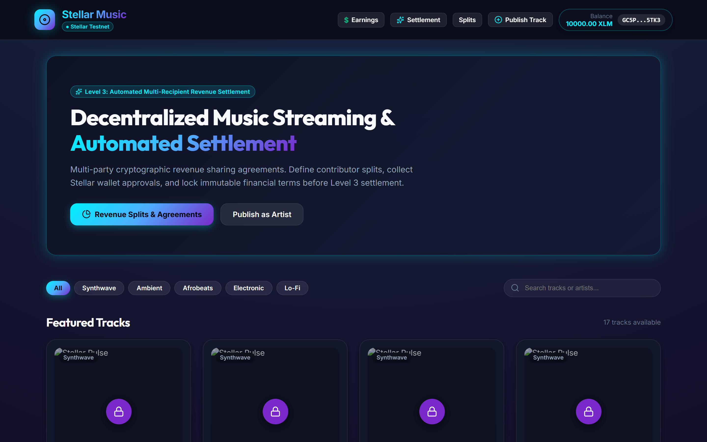
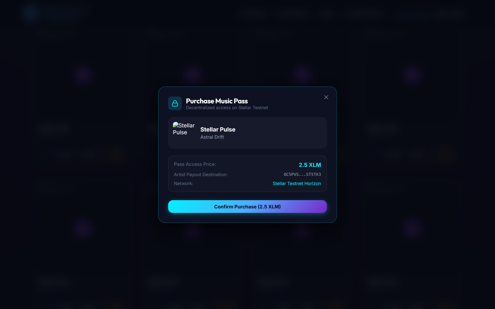
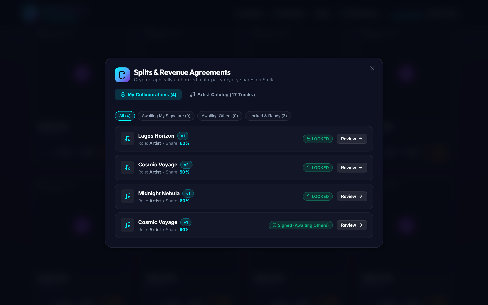
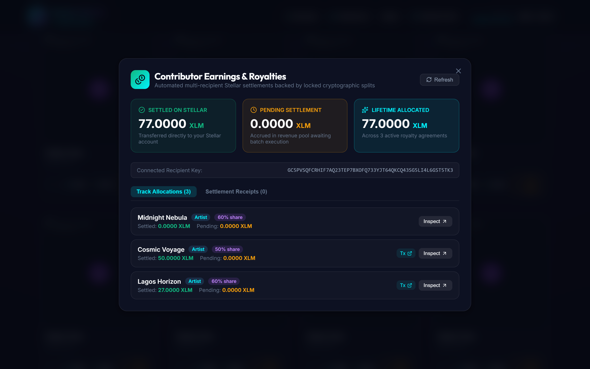
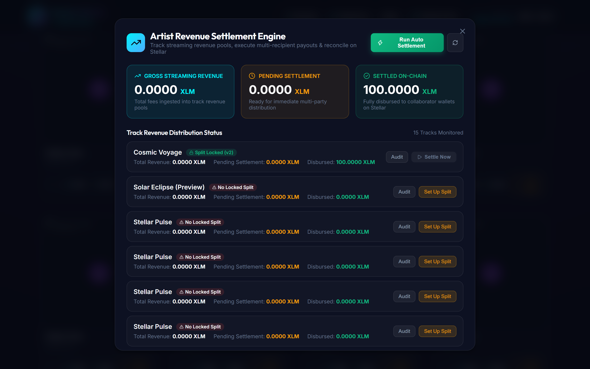
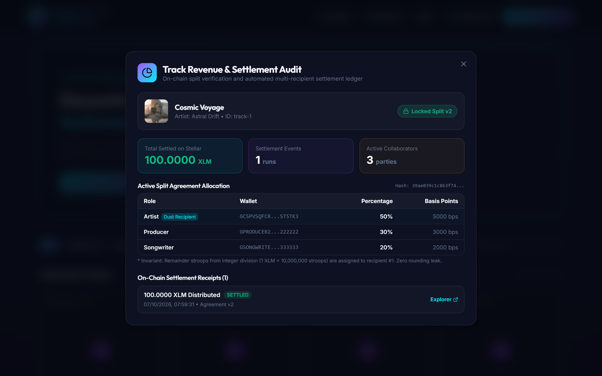

# 🎵 Stellar Music — Smart Contracts (`stellar-music-contracts`)

[](https://stellar-music-app.netlify.app)
[](https://stellar.expert/explorer/testnet/contract/CBUNX6PF4OOFGQ434IBVCLRBR6OBQOM5PTYUES7X6KSN2AIER6VMJK7K)
[](https://stellar.org)
[](https://github.com/Stellar-Music/stellar-music-contracts)
[](https://github.com/Stellar-Music/stellar-music-contracts/releases/tag/v1.1.0-wave)
[](https://github.com/Stellar-Music/stellar-music-contracts/actions)

The decentralized financial engine and settlement protocol for **Stellar Music**, built on **Soroban (Rust SDK v22)** for the **Stellar Network**.

---

## 🏛️ Ecosystem Architecture & Repository Directory

Stellar Music is engineered as a three-tier decentralized streaming application:

| Repository | Responsibility | Tech Stack | Status | Tests |
| :--- | :--- | :--- | :---: | :---: |
| **[`stellar-music-contracts`](https://github.com/Stellar-Music/stellar-music-contracts)** | Non-custodial splits, passes, 0-stroop invariant engine | Soroban / Rust SDK v22 | **Deployed** | **36 / 36** |
| **[`stellar-music-backend`](https://github.com/Stellar-Music/stellar-music-backend)** | Audio streaming, SSE settlements, Horizon failover pool | Node.js / TypeScript / SQLite / Express | **Active** | **92 / 92** |
| **[`stellar-music-frontend`](https://github.com/Stellar-Music/stellar-music-frontend)** | Reactive Web3 player, PWA, Freighter wallet connector | React 18 / TypeScript / Vite / Tailwind | **Live** | **130 / 130** |

* **Total Protocol Automated Tests**: **258 / 258 passing** across contracts, backend, and frontend.
* **Live Production dApp**: [https://stellar-music-app.netlify.app](https://stellar-music-app.netlify.app)

---

## 🌐 Live Testnet Deployment

The smart contract is live, deployed, and initialized on the **Stellar Testnet**:

| Parameter | Value | Explorer Link |
| :--- | :--- | :--- |
| **Contract ID** | `CBUNX6PF4OOFGQ434IBVCLRBR6OBQOM5PTYUES7X6KSN2AIER6VMJK7K` | [StellarExpert Contract Explorer](https://stellar.expert/explorer/testnet/contract/CBUNX6PF4OOFGQ434IBVCLRBR6OBQOM5PTYUES7X6KSN2AIER6VMJK7K) |
| **Admin Account** | `GCMMDSL3RW5SHGAXEOW6G5M7KZ2CFWUPUKV5Q5L2NBTUA6F4RK45NE7F` | [StellarExpert Account Explorer](https://stellar.expert/explorer/testnet/account/GCMMDSL3RW5SHGAXEOW6G5M7KZ2CFWUPUKV5Q5L2NBTUA6F4RK45NE7F) |
| **WASM Hash** | `ee0cda1ecc85f3233df94fecbbdd2bbd56305a894e51f3432082dfa0770b9895` | [WASM Bytecode](deployments/testnet.json) |
| **Deployment Tx** | `32408fc621838119d27a89f3fbd968201751582b7363943c97d226cdbe4249a6` | [View Deployment Tx](https://stellar.expert/explorer/testnet/tx/32408fc621838119d27a89f3fbd968201751582b7363943c97d226cdbe4249a6) |
| **Initialization Tx** | `14a573d53a7d3b27e6cad7abb233a61c9cae0ae304cdffb8b1472713a2fe886d` | [View Init Tx](https://stellar.expert/explorer/testnet/tx/14a573d53a7d3b27e6cad7abb233a61c9cae0ae304cdffb8b1472713a2fe886d) |

---

## 📌 Protocol Overview

Stellar Music eliminates opaque royalty distribution and intermediary payment delays by embedding revenue agreements and payouts directly into Stellar smart contracts:

1. **Non-Custodial Financial Enforcement**: Neither artists, listeners, nor platform servers have unilateral custody of funds. Smart contract rules govern all transactions.
2. **Cryptographic Revenue Split Agreements**: Collaborators (producers, vocalists, songwriters) register and sign immutable split agreements on-chain. Exactly 10,000 basis points (100.00%) are allocated, verified, and locked.
3. **Automated Multi-Recipient Settlements**: Streaming revenue ingested into track pools is automatically distributed to all verified collaborator wallets in a single atomic transaction.
4. **Zero-Leak Integer Stroop Math**: 1 XLM = 10,000,000 stroops. Indivisible remainder dust is deterministically assigned to the primary collaborator (index 0), guaranteeing zero financial rounding leakage across any number of split participants.

```
                     ┌────────────────────────────────┐
                     │     Music Pass Streaming Fee   │
                     └───────────────┬────────────────┘
                                     │
                                     ▼
                     ┌────────────────────────────────┐
                     │    Track Revenue Allocation    │
                     └───────────────┬────────────────┘
                                     │
                       (Locked Split Agreement Check)
                                     ▼
     ┌────────────────────────────────────────────────────────────────┐
     │                Soroban Split Settlement Engine                 │
     │  - Verifies Agreement Status == LOCKED                         │
     │  - Computes Integer Basis Points (gross_stroops * bps / 10000) │
     │  - Allocates Indivisible Remainder Stroops to Primary Artist   │
     │  - Atomically Transfers XLM to Every Contributor Wallet        │
     │  - Emits SettlementReceipt Event & Ledger Audit Record         │
     └───────┬──────────────────────┬──────────────────────┬──────────┘
             │                      │                      │
             ▼                      ▼                      ▼
    [ Producer (40%) ]     [ Vocalist (35%) ]      [ Writer (25%) ]
```

---

## 🎥 Comprehensive Video Walkthrough (with Voice-Over)

Watch the complete Soroban contract execution, multi-contributor split agreement locking, and automated multi-recipient settlement:

| Platform Tour & Walkthrough | Direct Access & Controls |
| :--- | :--- |
| <video src="https://stellar-music-app.netlify.app/videos/stellar-music-walkthrough.mp4" controls width="100%" poster="https://raw.githubusercontent.com/Stellar-Music/stellar-music-frontend/main/docs/screenshots/03_revenue_split_studio.png"><a href="https://stellar-music-app.netlify.app/walkthrough.html"></a></video> | • **[▶️ Watch on Standalone Netlify Player](https://stellar-music-app.netlify.app/walkthrough.html)**<br>• **[🌐 Open in Stellar Music App Tab](https://stellar-music-app.netlify.app/#walkthrough)**<br>• **[🎬 Direct MP4 Video Stream](https://stellar-music-app.netlify.app/videos/stellar-music-walkthrough.mp4)**<br>• **[🔗 GitHub Raw Video Stream](https://github.com/Stellar-Music/stellar-music-frontend/raw/main/public/videos/stellar-music-walkthrough.mp4)**<br>• **Resolution:** 1080p Full HD (1920x1080)<br>• **Capture Type:** Live Browser Execution Recording<br>• **Narration:** Azure Neural Voice (`en-US-GuyNeural`)<br>• **Runtime:** 1m 14s |

---

## 🛠️ Smart Contract Specification

### Core Methods

| Method | Parameters | Returns | Description |
| :--- | :--- | :--- | :--- |
| `initialize` | `admin: Address` | `Result<(), Error>` | Initializes contract administrator. |
| `register_track` | `artist: Address`, `pass_price: i128`, `metadata_uri: String` | `Result<u64, Error>` | Registers track on-chain with pass price and metadata URI. Emits `track::reg`. |
| `update_track` | `artist: Address`, `track_id: u64`, `pass_price: i128`, `is_active: bool` | `Result<(), Error>` | Updates track metadata and active status. Requires artist auth. |
| `purchase_pass` | `listener: Address`, `track_id: u64`, `token: Address` | `Result<PassInfo, Error>` | Purchases access pass. Transfers payment tokens directly to artist account. |
| `create_split_agreement` | `artist: Address`, `track_id: u64`, `agreement_hash: BytesN<32>`, `recipients: Vec<SplitRecipient>` | `Result<u32, Error>` | Registers a new split agreement version. Validates 10,000 bps invariant and recipient uniqueness. |
| `approve_split_agreement` | `contributor: Address`, `track_id: u64`, `version: u32`, `agreement_hash: BytesN<32>` | `Result<bool, Error>` | Contributor cryptographically approves agreement terms. Automatically transitions status to `LOCKED` when all parties sign. |
| `get_split_agreement` | `track_id: u64`, `version: u32` | `Option<SplitAgreement>` | Queries full agreement metadata, version, terms, approvals, and lock state. |
| `get_active_locked_split` | `track_id: u64` | `Option<SplitAgreement>` | Fetches active locked agreement ready for settlement execution. |
| `calculate_split_allocations` | `track_id: u64`, `gross_amount: i128` | `Result<Vec<RecipientPayout>, Error>` | Pure dry-run calculation returning exact stroop allocations and dust assignment. |
| `execute_split_settlement` | `caller: Address`, `track_id: u64`, `gross_amount: i128`, `token: Option<Address>` | `Result<SettlementReceipt, Error>` | Executes atomic multi-recipient transfer on Stellar backed by locked agreement. Disburses directly from escrow pool when funded. Emits `settle::done`. |
| `deposit_track_revenue` | `depositor: Address`, `track_id: u64`, `amount: i128`, `token: Address` | `Result<i128, Error>` | Deposits streaming royalty revenue into track escrow pool. Extends persistent storage TTL. Emits `pool::dpst`. |
| `withdraw_track_revenue` | `artist: Address`, `track_id: u64`, `amount: i128`, `token: Address` | `Result<i128, Error>` | Allows track artist to withdraw accumulated revenue from track escrow pool with authentication. Emits `pool::wthdrw`. |
| `upgrade` | `admin: Address`, `new_wasm_hash: BytesN<32>` | `Result<(), Error>` | Upgrades contract bytecode via Soroban deployer. Requires admin auth. |
| `set_paused` | `admin: Address`, `paused: bool` | `Result<(), Error>` | Emergency circuit breaker to pause/unpause contract operations. |
| `is_paused` | *None* | `bool` | Checks if contract operations are currently paused. |
| `get_contract_version` | *None* | `(u32, u32, u32)` | Returns semantic contract version tuple `(major, minor, patch)`. |
| `get_settlement` | `settlement_id: u64` | `Option<SettlementReceipt>` | Queries on-chain settlement receipt by global settlement index. |
| `get_settlement_count` | *None* | `u64` | Returns total lifetime settlements executed on the contract. |
| `get_track_settled_total` | `track_id: u64` | `i128` | Returns lifetime cumulative settled amount for a specific track. |

---

## 🔒 Financial Invariants & Security Architecture

1. **Exact 100.00% Allocation (`InvalidBasisPoints`)**: Every agreement must total exactly 10,000 basis points. Under-allocation or over-allocation is rejected at transaction submission.
2. **Duplicate Prevention (`DuplicateRecipient`)**: A wallet cannot be specified multiple times within the same split agreement.
3. **Lock Gatekeeper (`AgreementNotLocked`)**: Settlement execution is strictly prohibited unless the agreement has reached the `LOCKED` state through unanimous multi-party cryptographic approvals.
4. **Remainder Dust Zero-Leak Invariant**:
   All monetary computations use integer arithmetic in Stellar stroops (`1 XLM = 10,000,000 stroops`). Indivisible dust remainder resulting from integer division is deterministically allocated to recipient 0:
   ```text
   dust = gross_amount - sum(floor(gross_amount * bps[i] / 10,000))
   actual_amount[0] = calculated_amount[0] + dust

   Invariant: sum(actual_amount[0..n-1]) == gross_amount
   ```
5. **Replay & Hash Binding**: Every approval requires passing the agreement's SHA-256 hash. If terms are modified, previous signatures are rendered invalid.

---

## 🛑 Smart Contract Error Codes & Failure Modes

The contract implements strongly typed errors via `soroban_sdk::contracterror`. Any assertion failure returns the corresponding enum error code to the caller:

| Error Code | Variant Name | Trigger Condition & Description |
| :---: | :--- | :--- |
| `1` | `AlreadyInitialized` | Attempted to re-initialize contract state. The `initialize` function can only execute once. |
| `2` | `NotInitialized` | Contract storage has not been initialized with an administrator address. |
| `3` | `NotAuthorized` | Caller authentication check failed; transaction signer is unauthorized. |
| `4` | `TrackNotFound` | The requested `track_id` does not exist on-chain. |
| `5` | `TrackInactive` | Track has been deactivated by the artist; access pass purchases are halted. |
| `6` | `PassAlreadyPurchased` | The listener wallet already owns an active access pass for this track. |
| `7` | `InvalidPrice` | Pass price must be non-negative (`pass_price >= 0`). |
| `8` | `InvalidBasisPoints` | Sum of recipient basis points does not equal exactly 10,000 (100.00%). |
| `9` | `SplitAlreadyLocked` | Agreement is already in `LOCKED` status and cannot be modified or re-approved. |
| `10` | `AgreementNotFound` | Specified split agreement version does not exist for the track. |
| `11` | `NotARecipient` | Signing address is not registered in the split agreement recipient list. |
| `12` | `AlreadyApproved` | Contributor has already signed and approved this agreement version. |
| `13` | `HashMismatch` | Provided SHA-256 agreement hash does not match the terms registered on-chain. |
| `14` | `DuplicateRecipient` | A recipient wallet address was provided more than once in the same agreement. |
| `15` | `NoRecipients` | Agreement was submitted with an empty recipient list. |
| `16` | `AgreementNotLocked` | Settlement execution attempted on an agreement that has not been `LOCKED` by all contributors. |
| `17` | `InvalidSettlementAmount` | Settlement gross amount must be strictly greater than zero (`gross_amount > 0`). |
| `18` | `ContractPaused` | Contract is currently paused under emergency circuit breaker. |
| `19` | `PriceTooLow` | Pass price is below the `MIN_PASS_PRICE` floor (0.01 XLM). |
| `20` | `TooManyRecipients` | Number of split recipients exceeds `MAX_RECIPIENTS` limit (25). |
| `21` | `TrackArchived` | Track is archived and cannot receive new pass purchases. |
| `22` | `MetadataUriEmpty` | Metadata URI string cannot be empty. |
| `23` | `InvalidFeeBps` | Platform fee basis points exceed `MAX_PLATFORM_FEE_BPS` ceiling (10.00%). |
| `24` | `ZeroDeposit` | Revenue deposit amount must be strictly greater than zero. |

---

## 📸 Product Functionality Walkthrough

The smart contract suite directly powers the complete decentralized streaming and settlement workflow:

### 1. Catalog Discovery & Range Audio Streaming
Verified on-chain tracks are streamed with authenticated HTTP 206 range delivery. The persistent player manages playback, volume, and seeking.


---

### 2. Non-Custodial Music Pass Access (`purchase_pass`)
Listeners purchase track access passes using native Stellar Testnet XLM. Funds transfer directly to artist accounts with cryptographic replay protection.


---

### 3. Collaborator Revenue Split Studio (`create_split_agreement`, `approve_split_agreement`)
Collaborators configure exact basis points totaling 10,000 (100.00%). When all parties cryptographically sign, the status automatically transitions to `LOCKED`.


---

### 4. Contributor Royalty & Earnings Dashboard (`get_track_settled_total`)
Collaborators monitor lifetime earnings, pending pool royalties, and settled XLM on Stellar with direct links to blockchain transaction receipts.


---

### 5. Automated Multi-Recipient Settlement Engine (`execute_split_settlement`)
Artists view catalog gross revenue, pending balances, and execute automated multi-recipient settlement batches in a single on-chain transaction.


---

### 6. Public Track Revenue & Settlement Auditor (`calculate_split_allocations`, `get_settlement`)
Publicly inspect per-track revenue pools, verify immutable split terms, confirm remainder dust allocation to Index 0, and audit on-chain settlement receipts.


---

## 📊 Data Structures

```rust
pub struct SplitRecipient {
    pub recipient: Address,
    pub role: Symbol,             // e.g. "artist", "producer", "songwrtr", "engineer"
    pub share_basis_points: u32, // 10,000 bps = 100.00%
}

pub struct SplitAgreement {
    pub track_id: u64,
    pub version: u32,
    pub agreement_hash: BytesN<32>, // Deterministic SHA-256 of agreement terms
    pub recipients: Vec<SplitRecipient>,
    pub approvals: Vec<Address>,   // Collected cryptographic approvals
    pub is_locked: bool,           // Immutable once all required parties sign
    pub created_at: u64,
    pub locked_at: u64,
}

pub struct SettlementReceipt {
    pub settlement_id: u64,
    pub track_id: u64,
    pub agreement_version: u32,
    pub gross_amount: i128,
    pub recipient_count: u32,
    pub settled_at: u64,
    pub ledger_sequence: u32,
}

pub struct RecipientPayout {
    pub recipient: Address,
    pub role: Symbol,
    pub basis_points: u32,
    pub amount: i128,
}
```

---

## 🧪 Testing & Verification

The contract includes comprehensive test suites covering unit logic, multi-party signature flows, basis points validation, and multi-recipient settlement execution:

```bash
# Run contract unit tests
cargo test --lib

# Build optimized WASM binary for deployment
cargo build --target wasm32-unknown-unknown --release
```

All 36 automated unit, security, and financial invariant test cases pass with zero failures:
* `test_contract_initialization` — Initializes contract state and verifies admin configuration.
* `test_contract_version` — Validates semantic versioning invariants `(1, 1, 0)`.
* `test_contract_upgrade` — Verifies administrator-only WASM bytecode upgrades.
* `test_admin_transfer_and_authorization` — Validates two-step admin role transfers with authentication.
* `test_contract_error_codes_exhaustive` — Asserts all 24 typed Soroban error enum codes.
* `test_contract_event_emission_verification` — Confirms event publication across track, pass, split, and settlement flows.
* `test_emergency_pause_and_unpause` — Tests emergency circuit breaker operation toggling.
* `test_emergency_pause_settlement_blocking` — Prohibits monetary settlements while contract is paused.
* `test_register_track` — Registers track with pricing floor enforcement and metadata URI.
* `test_update_metadata_uri_and_validation` — Updates track metadata and active status with artist authorization.
* `test_track_archive_and_purchase_blocking` — Confirms archived tracks reject new pass purchases.
* `test_minimum_pass_price_enforcement` — Rejects prices below the 0.01 XLM (100,000 stroops) floor.
* `test_purchase_pass_and_payment_transfer` — Executes access pass purchase and non-custodial token transfer.
* `test_tiered_pass_purchase` — Tests tiered pass purchases across multiple price levels.
* `test_bulk_pass_check_and_listener_pass_count` — Validates listener pass inventory queries.
* `test_pass_timestamp_and_ledger_sequence_invariant` — Verifies ledger timestamps and sequence recordings on passes.
* `test_maximum_supply_cap_invariant` — Enforces pass supply limits.
* `test_level2_create_split_agreement_success` — Creates new split agreement with multi-recipient share configuration.
* `test_level2_reject_invalid_basis_points` — Rejects split agreements whose basis points do not sum to exactly 10,000 (100.00%).
* `test_level2_reject_duplicate_recipient` — Enforces address uniqueness within a split agreement.
* `test_level2_multi_party_signing_flow_and_lock` — Verifies multi-party cryptographic signature collection and automated transition to `LOCKED`.
* `test_level2_non_recipient_cannot_approve` — Prevents unauthorized third parties from signing split agreements.
* `test_level2_hash_mismatch_rejection` — Rejects approvals submitted against modified agreement terms.
* `test_unauthorized_signer_rejection` — Blocks non-recipients from participating in agreement signing.
* `test_maximum_recipients_limit` — Enforces `MAX_RECIPIENTS` boundary (25 recipients).
* `test_level3_settlement_calculation_and_execution` — Computes 4-way multi-recipient settlement and verifies atomic execution.
* `test_level3_settlement_rejection_when_unlocked` — Prohibits revenue settlement against unconfirmed or unlocked agreements.
* `test_level3_settlement_invariant_and_rounding_dust` — Validates stroop remainder dust allocation to Index 0 with zero rounding leak.
* `test_contract_stroop_loss_invariant` — Proves zero financial precision leakage across multi-participant splits.
* `test_track_escrow_deposit_and_settlement_from_contract_pool` — Deposits revenue into escrow pool and verifies direct atomic disbursement from contract balance.
* `test_track_escrow_deposit_and_artist_withdraw` — Verifies authenticated artist withdrawal of accumulated track escrow balances.
* `test_artist_treasury_withdraw` — Tests platform fee treasury withdrawals with authorization.
* `test_platform_fee_configuration_and_caps` — Enforces platform fee maximum ceiling (10.00%).
* `test_signature_replay_defense` — Verifies rejection of replayed transactions.
* `test_sac_token_transfer_cross_contract` — Tests Stellar Asset Contract (SAC) cross-contract transfers.
* `test_fuzz_purchase_pass_boundaries` — Boundary condition stress testing under simulated randomized loads.

---

## 🌐 Network & Ecosystem Links

* **Live Web Application**: [https://stellar-music-app.netlify.app](https://stellar-music-app.netlify.app)
* **Frontend Web Application Repo**: [Stellar-Music/stellar-music-frontend](https://github.com/Stellar-Music/stellar-music-frontend)
* **Backend API & Settlement Engine Repo**: [Stellar-Music/stellar-music-backend](https://github.com/Stellar-Music/stellar-music-backend)
* **Smart Contracts Repo**: [Stellar-Music/stellar-music-contracts](https://github.com/Stellar-Music/stellar-music-contracts)
* **Stellar Network**: Testnet
* **Soroban RPC**: `https://soroban-testnet.stellar.org`
* **Network Passphrase**: `Test SDF Network ; September 2015`
* **Testnet Explorer**: [Stellar Expert Explorer](https://stellar.expert/explorer/testnet)
