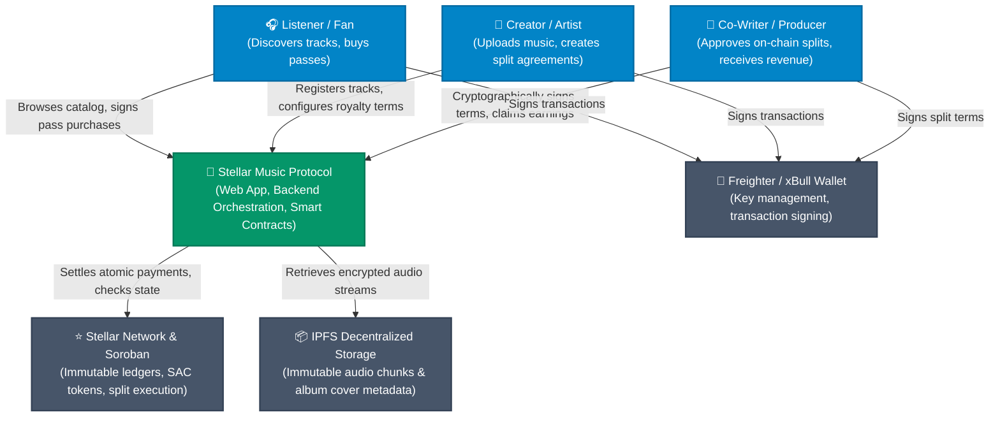
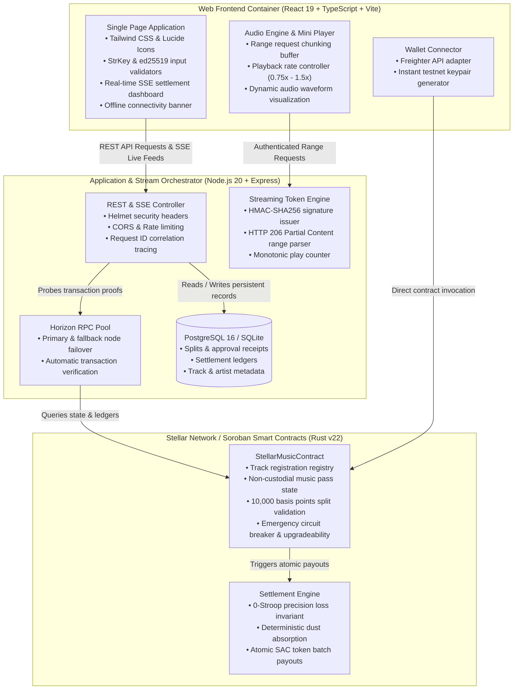

# Stellar Music Protocol — System Architecture Specification

## 1. Executive Summary

**Stellar Music** is a decentralized, streaming-native music monetization platform built on the Stellar Network and Soroban smart contracts. It replaces opaque, slow traditional streaming royalty distribution with direct, peer-to-peer artist patronage, non-custodial music passes, and real-time on-chain revenue settlement.

---

## 2. C4 Context Diagram (System In Environment)

---

## 3. C4 Container Diagram (Internal Component Topography)

---

## 4. Key Architectural Guarantees

1. **Non-Custodial Escrow**: Neither the server nor the artists ever take unilateral custody of listener subscription funds. Smart contracts enforce deterministic payment routing.
2. **Deterministic Stroop Arithmetic**: 1 XLM = 10,000,000 stroops. Indivisible dust is absorbed by index 0, guaranteeing zero rounding leakage across any number of contributors.
3. **Stateless Low-Latency Streaming**: Streaming authorization utilizes short-lived HMAC-SHA256 tokens validated in $O(1)$ memory without per-chunk database roundtrips.
4. **Defensive RPC Resilience**: Dual-endpoint Horizon RPC pooling shields client and server operations from single-node rate limits or network dropouts.

