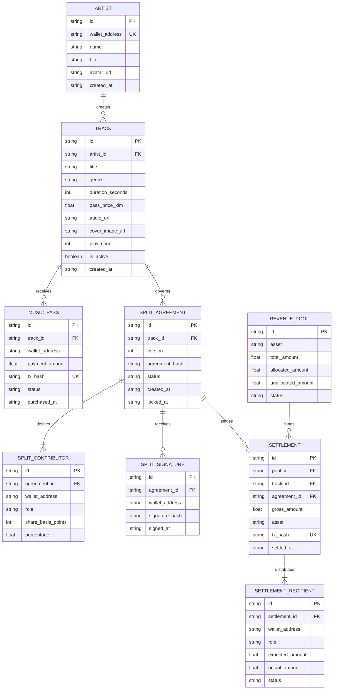

# Stellar Music Protocol — Database Schema & Entity Relationship Specification

## 1. Entity-Relationship Diagram (ERD)

---

## 2. Relational Integrity & Performance Indexes

| Table | Index Name | Columns | Purpose |
| :--- | :--- | :--- | :--- |
| `artists` | `idx_artists_wallet` | `wallet_address` | $O(1)$ Artist profile resolution |
| `tracks` | `idx_tracks_artist` | `artist_id` | Catalog queries by creator |
| `music_passes` | `idx_passes_track_wallet` | `track_id, wallet_address` | Instant pass holding lookup |
| `music_passes` | `idx_passes_tx_hash` | `tx_hash` (Unique) | Anti-replay duplicate protection |
| `split_agreements` | `idx_splits_track_ver` | `track_id, version` | Versioned terms inspection |
| `settlements` | `idx_settlements_track` | `track_id` | Lifetime earnings reporting |
| `settlements` | `idx_settlements_tx_hash` | `tx_hash` (Unique) | On-chain settlement receipt linkage |
| `settlement_recipients`| `idx_recipients_wallet` | `wallet_address` | Collaborator aggregate balance queries |
