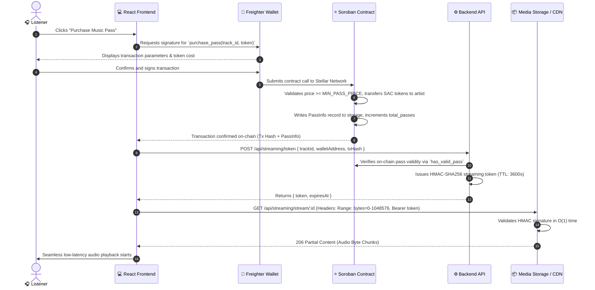
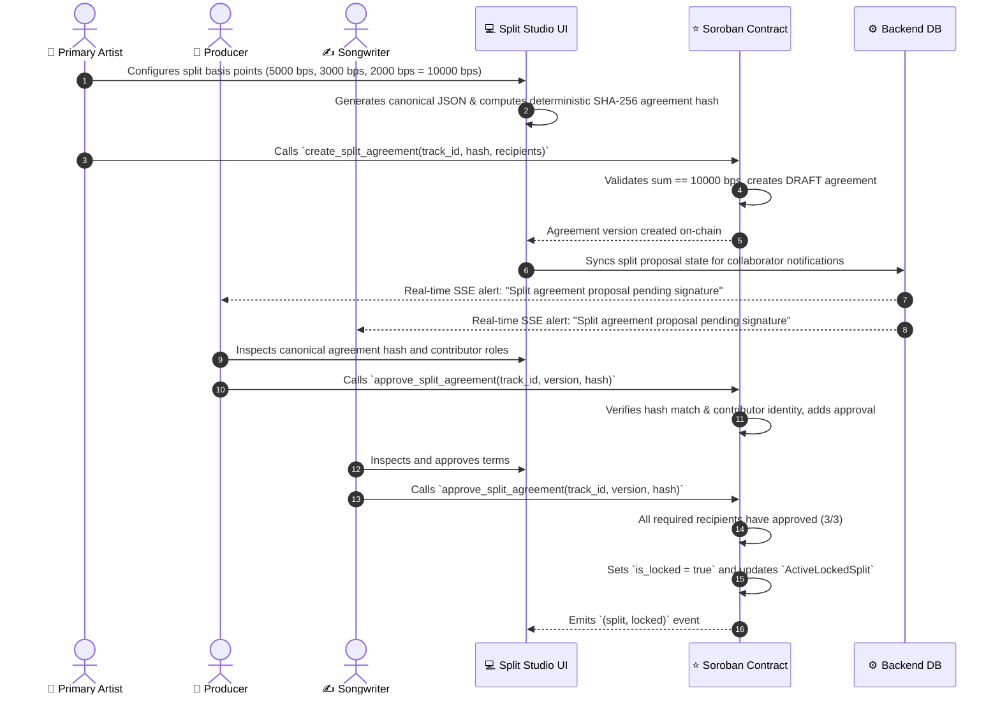
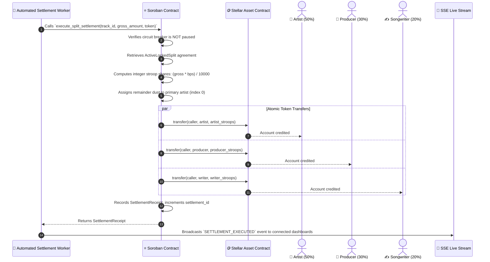

# Stellar Music Protocol — End-to-End Sequence Flow Specifications

This document outlines the end-to-end cryptographic and financial sequence flows governing **Stellar Music**.

---

## 1. Flow 1: Music Pass Purchase & Streaming Session Flow

---

## 2. Flow 2: Multi-Party Split Proposal, Signing & On-Chain Locking

---

## 3. Flow 3: Automated Revenue Settlement & 0-Stroop Distribution

