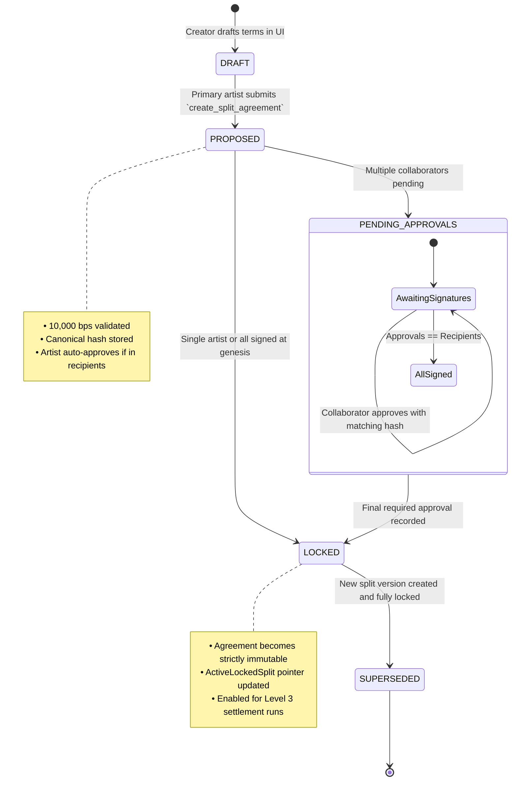

# Stellar Music Protocol — Split Agreement State Machine Specification

## 1. Overview

Collaborative music creation requires transparent, non-repudiable agreement between multiple rights-holders. The **Stellar Music Split State Machine** governs the lifecycle of revenue distribution terms from initial collaborative draft to immutable on-chain settlement enforcement.

---

## 2. State Transition Diagram

---

## 3. State Definitions & Operational Rules

### 3.1 `DRAFT` (Off-Chain Client State)
- **Description**: Contributors, roles, and percentages are configured in the frontend Split Studio.
- **Rules**:
  - Basis points must sum to 10,000 (100.00%).
  - Maximum recipient cap enforced ($k \le 25$).
  - Canonical JSON string generated and hashed via SHA-256.

### 3.2 `PROPOSED` / `PENDING_APPROVALS` (On-Chain Pending State)
- **Description**: Stored on-chain in `DataKey::SplitAgreement(track_id, version)`.
- **Rules**:
  - `is_locked = false`.
  - Level 3 settlements cannot execute against this version (`Error::AgreementNotLocked`).
  - Collaborators call `approve_split_agreement(contributor, track_id, version, agreement_hash)`.
  - Hash mismatch strictly rejected (`Error::HashMismatch`).

### 3.3 `LOCKED` (Authoritative Settlement State)
- **Description**: Unanimous cryptographic consensus reached ($|Approvals| = |Recipients|$).
- **Rules**:
  - Agreement is permanently frozen and immutable.
  - No additional approvals or modifications permitted (`Error::SplitAlreadyLocked`).
  - Active settlement pointer set: `DataKey::ActiveLockedSplit(track_id) = version`.
  - Authorized for atomic token revenue distributions.

### 3.4 `SUPERSEDED` (Historical Archive State)
- **Description**: A prior locked split agreement replaced by a newer version (e.g. Version 2 locked, superseding Version 1).
- **Rules**:
  - Historical settlement audit receipts permanently reference the version in effect at settlement time.
